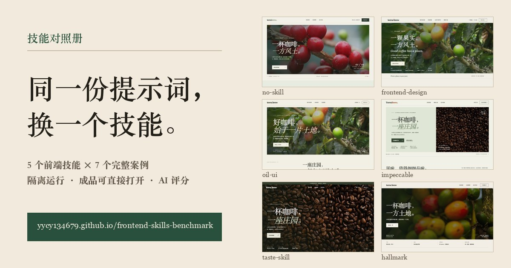

# Frontend Skills Benchmark

English | [简体中文](README.md)

Same prompt, same model, different frontend skill. This repo compares the pages an AI coding agent builds **without any skill** against the pages it builds with **exactly one frontend skill** loaded, and keeps every generated page so you can open and use it yourself instead of judging from screenshots.

**Live gallery: <https://yycy134679.github.io/frontend-skills-benchmark/>**



The gallery, prompts, and per-case records are written in Chinese. Every generated page is a self-contained HTML file, so you can click straight into the results without reading the notes.

## What is compared

Skills under test (snapshots with upstream commit and license are listed in [frontend-skills/README.md](frontend-skills/README.md)):

| Skill                   | Source                                                                                     | License    |
| ----------------------- | ------------------------------------------------------------------------------------------ | ---------- |
| `frontend-design`       | [anthropics/skills](https://github.com/anthropics/skills/tree/main/skills/frontend-design) | Apache 2.0 |
| `impeccable`            | [pbakaus/impeccable](https://github.com/pbakaus/impeccable)                                | Apache 2.0 |
| `design-taste-frontend` | [leonxlnx/taste-skill](https://github.com/leonxlnx/taste-skill)                            | MIT        |
| `hallmark`              | [Nutlope/hallmark](https://github.com/Nutlope/hallmark)                                    | MIT        |
| `oil-ui`                | [oil-oil/oil-ui](https://github.com/oil-oil/oil-ui)                                        | MIT        |

Cases so far (each has a no-skill baseline plus one run per skill):

| #   | Case                                                | Record (Chinese)                         |
| --- | --------------------------------------------------- | ---------------------------------------- |
| 01  | Specialty coffee subscription site                  | [对照记录](examples/case-01/对照记录.md) |
| 02  | Picture-book illustrator portfolio                  | [对照记录](examples/case-02/对照记录.md) |
| 03  | Vinyl music player                                  | [对照记录](examples/case-03/对照记录.md) |
| 04  | Landing page for "Orvo", a fictional AI app builder | [对照记录](examples/case-04/对照记录.md) |
| 05  | Indie developer homepage + article page             | [对照记录](examples/case-05/对照记录.md) |
| 06  | Promo page for a Chinese pop song                   | [对照记录](examples/case-06/对照记录.md) |
| 07  | 22nd birthday greeting page                         | [对照记录](examples/case-07/对照记录.md) |

Full prompts are in [案例提示词.md](案例提示词.md).

## Method

- **One variable.** Every group in a case uses the same prompt, the same model, and the same reasoning effort. The only difference is which skill (if any) is mounted.
- **Isolated runs.** Each group runs in its own headless Claude Code process ([bench/run.sh](bench/run.sh)) with a throwaway config directory, global `CLAUDE.md` disabled, bundled skills disabled, an empty MCP config, and a single-skill plugin. The output directory must live outside the repo so the agent cannot read earlier results.
- **Verified, not assumed.** [bench/verify_run.py](bench/verify_run.py) reads the session logs and fails the run unless the skill list, the skill invocations, and the models actually used match what was requested. The no-skill baseline must invoke zero skills.
- **AI scoring.** After all groups of a case are archived, an AI reviewer opens each page in a real browser at 1440×900, exercises the interactions, reads the source, and scores it on five dimensions (requirement fit, visual design, interaction and motion, accessibility, code quality; 100 points total) according to [评分规则.md](评分规则.md). Older cases are still being scored; unscored cards show a short first-screen note instead.

> [!NOTE]
> Each group is usually generated once, and results vary with the model and the service. Concurrent runs also make timing incomparable between groups. Treat these cases as a way to see how skills change the output, not as a ranking.

## Browse locally

```bash
git clone https://github.com/yycy134679/frontend-skills-benchmark.git
cd frontend-skills-benchmark
python3 -m http.server 8765 --directory .
```

Then open <http://localhost:8765/>. Opening `index.html` directly also works; no build step or dependencies are needed.

## Run your own comparison

Requirements: Claude Code, Python 3, Bash. For the Anthropic API, log in with the `claude` CLI first and pass an official model ID such as `claude-opus-5-5`. For any other Anthropic-compatible model service, export `ANTHROPIC_BASE_URL` and `ANTHROPIC_AUTH_TOKEN`.

```bash
bash bench/run.sh \
  --prompt /path/to/case.md \
  --skill oil-ui \
  --skill-dir frontend-skills/oil-ui \
  --model <model-id> \
  --out "$HOME/benchmark-runs/example-oil-ui"
```

`--skill` takes the skill's own `name` from its `SKILL.md` (for example, `frontend-skills/taste-skill` is `design-taste-frontend`). For the baseline, drop `--skill` and `--skill-dir` and use a new output directory. Keep `--model` and `--effort` identical across groups. Details and known pitfalls are in [bench/README.md](bench/README.md) (Chinese).

## Repository layout

| Path                                 | Contents                                                   |
| ------------------------------------ | ---------------------------------------------------------- |
| [index.html](index.html)             | Static gallery                                             |
| [examples/](examples/)               | Generated pages, run records, and scoring records per case |
| [assets/previews/](assets/previews/) | 1440×900 first-screen screenshots used by the gallery      |
| [frontend-skills/](frontend-skills/) | Read-only snapshots of the skills under test               |
| [bench/](bench/)                     | Isolated runner and verification scripts with tests        |
| [评分规则.md](评分规则.md)           | Scoring rubric                                             |
| [案例提示词.md](案例提示词.md)       | Case prompts                                               |

## License

The repository's own content (gallery, scripts, generated pages, and records) is released under the [MIT License](LICENSE). Skill snapshots under [frontend-skills/](frontend-skills/) keep their upstream licenses; see the license file in each skill directory.

## Community Support

- [Linux.do](https://linux.do/)